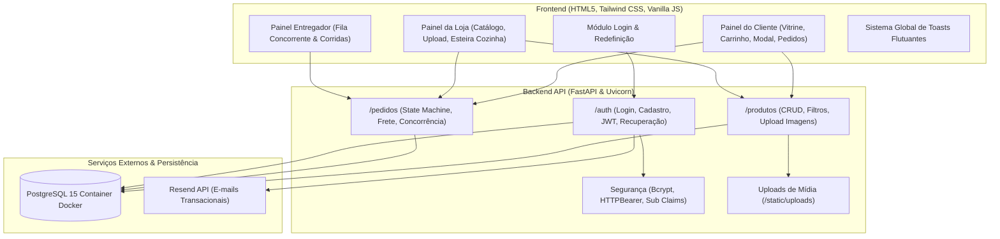
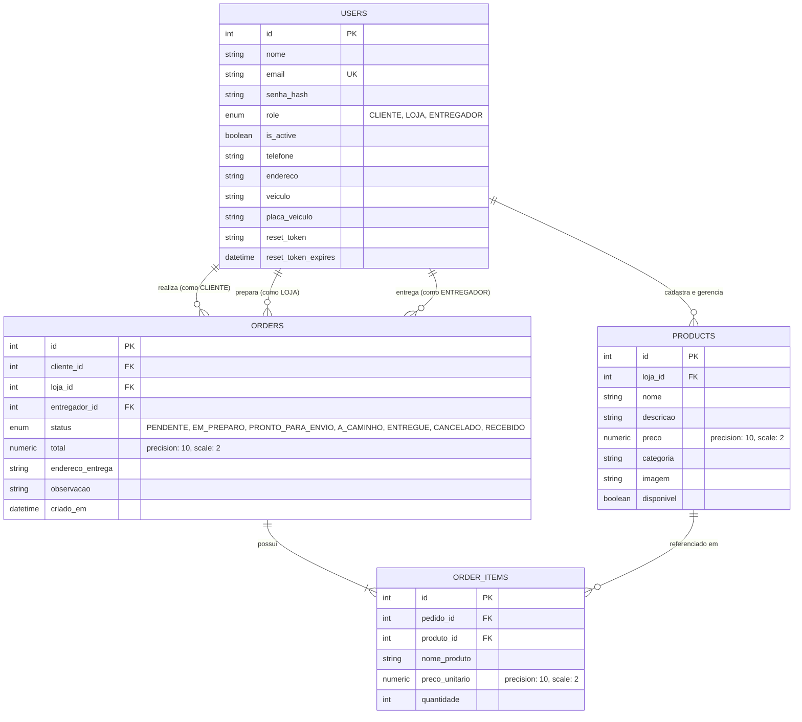
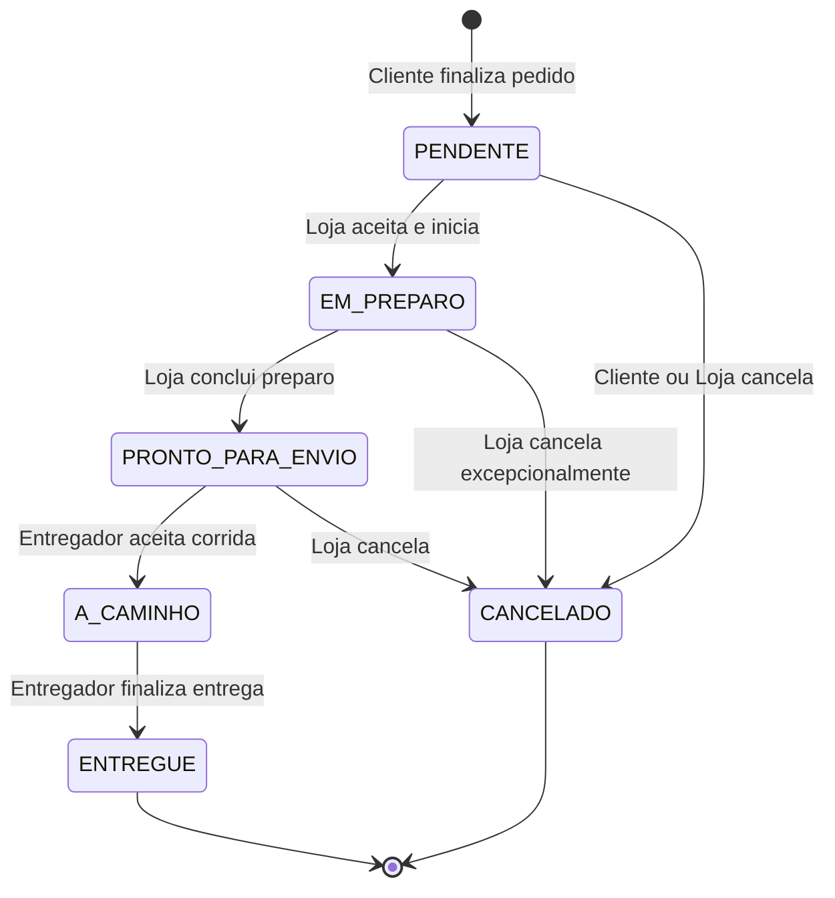

# RELATÓRIO TÉCNICO DE ENGENHARIA DE SOFTWARE
## Plataforma Integrada de Cardápio Digital e Gestão de Delivery

---

### IDENTIFICAÇÃO DO PROJETO E EQUIPE
* **Projeto:** Cardápio Digital
* **Contexto:** Projeto Acadêmico / Conclusão — Faculdade Grau
* **Versão Avaliada:** v0.2.0 (Estável / Pós-ciclo de refinamento e testes de bugs)
* **Equipe de Desenvolvimento:**
  * **Mariana Andrade** (Desenvolvimento Frontend, UX/UI, Validações e Sincronização)
  * **Jr. Silva** (Desenvolvimento Backend, Autenticação, Modelagem e Regras de Negócio)
  * **Anderson Souza** (Desenvolvimento Fullstack e Correções de Infraestrutura)
  * **Oseias Araujo** (Colaboração e Testes de Integração)
* **Repositório:** `projetofaculdadegrau/cardapio-digital`

---

## 1. RESUMO EXECUTIVO

O presente relatório técnico documenta o processo de concepção, modelagem, implementação, garantia de qualidade e resultados funcionais do sistema **Cardápio Digital**, desenvolvido no âmbito acadêmico da Faculdade Grau. 

O projeto soluciona uma deficiência crítica no mercado alimentício local: a inexistência de soluções digitais acessíveis, centralizadas e estáveis que conectem estabelecimentos comerciais, consumidores finais e profissionais de entrega. A solução foi projetada sob uma arquitetura desacoplada client-server fundamentada em uma **API RESTful de alta performance em Python (FastAPI)** com persistência relacional **PostgreSQL**, e uma interface rica e responsiva desenvolvida em **HTML5/Vanilla JavaScript moderno e Tailwind CSS**, seguindo as diretrizes de design do **Material 3**.

Ao longo do ciclo de desenvolvimento, a equipe aplicou rigorosas práticas de engenharia de software, incluindo controle de versão estruturado (Git Flow com Pull Requests), controle de acesso baseado em papéis (RBAC com tokens JWT), tratamento de concorrência em banco de dados para aceite de pedidos, padronização visual com sistema global de notificações flutuantes (Toasts) e uma esteira completa de resolução de bugs auditável (BUG-01 a BUG-39). Os resultados comprovam a viabilidade técnica e a maturidade operacional do ecossistema.

---

## 2. INTRODUÇÃO E CONTEXTUALIZAÇÃO

### 2.1 Cenário e Justificativa
Pequenos e médios comércios gastronômicos frequentemente dependem de aplicativos agregadores terceirizados com altas taxas de intermediação ou operam de maneira rudimentar via aplicativos de mensagens instantâneas. Este cenário resulta em:
1. Desorganização no fluxo de pedidos e tempo de preparo excessivo na cozinha.
2. Atrito de usabilidade para o cliente final, que não conta com fotos, descrições detalhadas e filtros dinâmicos.
3. Gargalos na distribuição de entregas por falta de visibilidade em tempo real para entregadores.

### 2.2 Objetivos do Projeto
* **Objetivo Geral:** Conceber e implementar um sistema web integrado e escalável de cardápio digital e distribuição de pedidos, com interfaces dedicadas para Clientes, Lojas e Entregadores.
* **Objetivos Específicos:**
  * Desenvolver uma API RESTful robusta com documentação interativa OpenAPI/Swagger automática.
  * Estruturar um modelo relacional normalizado no PostgreSQL orquestrado via contêineres Docker.
  * Implementar autenticação segura stateless via JSON Web Tokens (JWT) com recuperação de credenciais via e-mail transacional.
  * Fornecer interfaces otimizadas para dispositivos móveis e desktops sem sobrecarga de frameworks pesados no cliente, garantindo velocidade e alta taxa de resposta.
  * Validar e corrigir iterativamente as falhas identificadas na fase de homologação (BUG-01 a BUG-39).

---

## 3. ARQUITETURA DA SOLUÇÃO E STACK TECNOLÓGICA

O ecossistema adota a arquitetura em camadas orientada a serviços (SOA / RESTful), segregando claramente a lógica de negócios e persistência (Backend) da experiência visual do usuário (Frontend).



### 3.1 Backend
* **FastAPI (v0.110.0+):** Framework assíncrono em Python com suporte nativo a tipagem estática, injeção de dependências e serialização de alta performance.
* **Uvicorn (v0.28.0+):** Servidor ASGI leve e de alta vazão para execução da aplicação.
* **SQLAlchemy (v2.0.0+):** ORM (*Object-Relational Mapping*) para mapeamento das entidades relacionais, gerenciamento de sessões e execução de consultas seguras contra SQL Injection.
* **Pydantic (v2.6.0+) & Pydantic-Settings:** Validação rigorosa de esquemas de entrada/saída, validação customizada com `@field_validator` (força de senha, consistência de payloads) e gestão de variáveis de ambiente.
* **Passlib (Bcrypt):** Hashing criptográfico unidirecional de senhas com geração de sal (*salt*) automática.
* **Python-Jose:** Geração, assinatura e decodificação de JSON Web Tokens (algoritmo HMAC-SHA256).

### 3.2 Banco de Dados e Infraestrutura
* **PostgreSQL 15 (Alpine):** Sistema gerenciador de banco de dados relacional (SGBD) robusto, garantindo integridade referencial, conformidade ACID e índices para chaves estrangeiras.
* **Docker & Docker Compose:** Isolamento do ambiente de persistência através de contêineres e volume persistente nomeado (`postgres_data`), garantindo portabilidade imediata entre as máquinas dos membros da equipe.

### 3.3 Frontend
* **Vanilla JavaScript Moderno (ES6+):** Código limpo sem dependência de bibliotecas de terceiros, garantindo tempo de carregamento praticamente instantâneo e total controle sobre o ciclo de vida do DOM.
* **Tailwind CSS & Material 3:** Utilização de classes utilitárias para composição de um *Design System* harmônico, com sombras suaves, cantos arredondados (`rounded-2xl`, `rounded-3xl`), tipografia refinada (DM Sans / Manrope) e micro-animações (`card-animate`).
* **Sistema Global de Notificações (`toast.js` / `toast.css`):** Módulo flutuante unificado com semântica de cores dinâmica para fornecer feedback imediato em todas as telas.

---

## 4. MODELAGEM DE DADOS E ESTRUTURA RELACIONAL

O esquema relacional foi desenhado para assegurar integridade referencial estrita e histórico financeiro imutável.

### 4.1 Diagrama Entidade-Relacionamento (ERD)



### 4.2 Detalhamento das Entidades

1. **`users`:** Armazena os usuários do sistema. A diferenciação de acesso ocorre via campo enumerado `role` (`CLIENTE`, `LOJA`, `ENTREGADOR`). Contém campos opcionais para logística de entregadores (`veiculo`, `placa_veiculo`) e suporte à recuperação de conta (`reset_token`, `reset_token_expires`).
2. **`products`:** Itens do catálogo gastronômico de cada loja. Possui integridade referencial com a tabela `users` via `loja_id`. O campo `preco` utiliza `Numeric(10, 2)` para evitar erros de ponto flutuante em operações contábeis.
3. **`orders`:** Representa a transação comercial. Associa três papéis simultaneamente: o cliente solicitante, a loja preparadora e o entregador transportador. Contém endereço de entrega congelado e carimbo de data/hora (`criado_em`).
4. **`order_items`:** Tabela associativa que congela o estado dos itens no momento da compra. Além do `produto_id`, armazena explicitamente `nome_produto` e `preco_unitario` para que futuras alterações ou exclusões no catálogo da loja não corrompam o histórico financeiro do pedido.

---

## 5. REGRAS DE NEGÓCIO E ENGENHARIA DE SOFTWARE

### 5.1 Controle de Acesso Baseado em Papéis (RBAC) e Segurança
* **Proteção de Rotas no Backend:** Uso do mecanismo de dependências do FastAPI (`Depends(get_current_user)`, `Depends(get_current_loja)`, `Depends(get_current_cliente)`, `Depends(get_current_entregador)`), interceptando requisições com cabeçalho `Authorization: Bearer <token>` e validando a role contida no payload do JWT.
* **Políticas de Senha:** Validação em duas frentes (frontend e backend via Pydantic) exigindo no mínimo 6 caracteres, ao menos uma letra maiúscula, uma minúscula e um número.
* **Recuperação Segura de Senha:** Endpoints `/auth/esqueci-senha` e `/auth/redefinir-senha`. Geração de tokens de alta entropia via `secrets.token_urlsafe(32)` com validade estrita de 15 minutos e disparos de e-mails em HTML responsivo via Resend API.
* **Route Guards no Frontend:** Verificação de autenticação e papel do usuário logo no carregamento das páginas através de checagem do `localStorage` (`access_token` e `user_role`), redirecionando automaticamente acessos indevidos.

### 5.2 Ciclo de Vida do Pedido (Máquina de Estados)
Para garantir integridade operacional, as transições de status são validadas restritivamente pelo backend:



### 5.3 Prevenção de Concorrência Crítica (Race Condition) no Aceite de Corridas
Quando múltiplos entregadores visualizam simultaneamente a mesma corrida disponível, uma atualização comum poderia provocar atribuição duplicada. Para mitigar esse problema, o sistema implementa uma atualização atômica condicional no banco de dados (`backend/app/orders.py`):

```python
quantidade_atualizada = (
    db.query(Order)
    .filter(
        Order.id == pedido_id,
        Order.status == OrderStatus.PRONTO_PARA_ENVIO,
        Order.entregador_id.is_(None),
    )
    .update(
        {
            Order.entregador_id: current_user.id,
            Order.status: OrderStatus.A_CAMINHO,
        },
        synchronize_session=False,
    )
)
```
Se `quantidade_atualizada == 0`, o sistema executa `db.rollback()` e emite um erro HTTP `409 Conflict`, notificando o segundo entregador de que a corrida já foi assumida por outro parceiro.

### 5.4 Precisão Monetária e Política de Frete
* Todos os cálculos financeiros no backend utilizam a biblioteca `Decimal` de precisão fixa com arredondamento seguro (`quantize(Decimal('0.01'))`), eliminando incongruências entre `float` e tipos numéricos do banco de dados (BUG corrigido no commit `ec5e0f10`).
* **Regra de Frete:** 
  * Se o subtotal do carrinho for maior ou igual a **R$ 30,00**, a taxa de entrega é **gratuita** (`R$ 0,00`).
  * Para valores inferiores a R$ 30,00, aplica-se uma taxa fixa de **R$ 5,00**.

### 5.5 Armazenamento e Upload Seguro de Imagens
* As imagens de produtos são validadas por extensão autorizada (`.jpg`, `.jpeg`, `.png`, `.webp`), renomeadas com identificadores únicos universais (`UUIDv4`) para prevenir colisões de nomes ou sobrescrita maliciosa, e salvas no diretório `/backend/uploads`.
* O diretório é servido estaticamente em `/static/uploads/` pelo FastAPI.

### 5.6 Sistema Global de Toasts Flutuantes (`toast.js` / `toast.css`)
Substituindo antigos alertas em bloco que causavam deslocamento de layout (*layout shift*), a equipe instituiu um sistema global de notificações flutuantes padronizado por cores e ícones Material:
* **Verde (`#26845b`):** Sucesso, cadastros e conclusões.
* **Azul (`#0284c7`):** Alterações de status, edições e avisos informativos.
* **Vermelho (`#ba1a1a`):** Erros de validação e exclusões definitivas.
* **Amarelo (`#ffc85e`):** Alertas de atenção e campos pendentes.

---

## 6. PROCESSO DE DESENVOLVIMENTO E HISTÓRICO DE MELHORIAS

A equipe utilizou o modelo de integração contínua apoiado em branches temáticas por desenvolvedor (`jr-silva`, `marih`, `anderson`) submetidas à branch principal via Pull Requests revisados.

### 6.1 Auditoria do Ciclo de Correção de Bugs (BUG-01 ao BUG-39)

Abaixo estão descritos os principais incidentes resolvidos durante a bateria de testes:

| Identificador | Componente | Descrição da Ocorrência | Solução Técnica Aplicada | Autor Principal |
| :--- | :--- | :--- | :--- | :--- |
| **BUG-01** | Backend / Schemas | Inconsistência nos tipos de validação de schemas de entrada | Ajuste nos tipos e campos opcionais do Pydantic | Jr. Silva |
| **BUG-04** | Frontend / Cliente | Falha na re-renderização dos botões do carrinho | Refatoração do estado local do carrinho e sincronização do DOM | Jr. Silva |
| **BUG-06** | Backend / Produtos | Configurações de paginação e filtros ausentes | Implementação de filtros por categoria e busca na rota `/produtos` | Jr. Silva |
| **BUG-07** | Backend / Main | Configuração incorreta de CORS impedindo requisições | Liberação das origens `127.0.0.1:5500` e `localhost:5500` | Jr. Silva |
| **BUG-10** | Backend / Pedidos | Permissão indevida no cancelamento de pedidos | Validação bloqueando cancelamento de pedidos já em preparo | Jr. Silva |
| **BUG-11 / 12** | Backend / Config | Problemas de caminhos absolutos para `.env` e uploads | Normalização com `pathlib.Path` e criação automática de pastas | Jr. Silva |
| **BUG-13 / 14** | Fullstack | Descompasso de atributos entre os modelos ORM e schemas | Padronização dos nomes de colunas e inclusão de relacionamentos | Jr. Silva |
| **BUG-17** | Regra de Negócio | Cliente recebia notificação de entrega antes do entregador aceitar | Criação do status intermediário `PRONTO_PARA_ENVIO` | Equipe |
| **BUG-20** | Frontend / Loja | Formulário de edição sobrescrevia o de criação na página da Loja | Criação de Modal dedicado (`modal-editar-produto`) com preview de imagem | Mariana Andrade |
| **BUG-26** | Frontend / Entregador | Travamento da interface do entregador ao atualizar painel | Correção de *race condition* na flag `acaoEmAndamento` com `forcar=true` | Mariana Andrade |
| **BUG-28** | Frontend Global | Alertas visuais despadronizados e estáticos nas páginas | Criação e distribuição do sistema universal `toast.js` e `toast.css` | Mariana Andrade |
| **BUG-29** | Frontend / Login | Telefone enviado sem formatação ou com dígitos incompletos | Máscara dinâmica com preservação de cursor e validação de DDD | Mariana Andrade |
| **BUG-31** | Frontend / Cliente | Barra de busca desktop e mobile desconectadas | Sincronização mútua com debounce, evento Enter e *scroll* até a vitrine | Mariana Andrade |
| **BUG-32** | Frontend / Cliente | Botão "Explorar Cardápio" no carrinho vazio não rolava até os pratos | Fechamento animado do drawer e *smooth scroll* para as categorias | Mariana Andrade |
| **BUG-34** | Frontend / Cliente | Pratos da vitrine não exibiam modal com foto expandida e detalhes | Desenvolvimento do Modal de Detalhes do Produto com suporte a tecla ESC | Mariana Andrade |
| **BUG-35** | Backend / Auth | Falta de fluxo de recuperação de senhas | Integração com Resend API, geração de token de 15 min e página de reset | Jr. Silva |
| **BUG-36** | Frontend / Login | Usuários criavam senhas fracas sem feedback em tempo real | Indicador visual dinâmico com checklist de requisitos de senha | Jr. Silva |
| **BUG-37** | Frontend Global | Eliminação de banners de aviso antigos e limpeza de CSS órfão | Remoção de tags `<div id="alerta">` e migração completa para Toasts | Mariana Andrade |
| **BUG-38 / 39** | Fullstack | Nome do estabelecimento não era visível nos cards de pedido do cliente | Criação da propriedade `@property loja_nome` nos models e schemas | Jr. Silva |
| **Frete Decimal** | Backend / Pedidos | Conflito de tipos entre Decimal e Float causava erro 500 no checkout | Conversão estrita de preços e taxas para `Decimal('0.00')` | Jr. Silva |

---

## 7. RESULTADOS OBTIDOS POR MÓDULO

### 7.1 Módulo de Acesso e Autenticação (`frontend/login`)
* **Interface Unificada:** Alternância fluida entre as abas de "Entrar" e "Criar Conta".
* **Seleção Dinâmica de Perfil:** Ajuste automático dos campos do formulário conforme a função selecionada (`Cliente`, `Estabelecimento` ou `Entregador`), exibindo dados de entrega ou veículo quando pertinente.
* **Validação de Credenciais em Tempo Real:** Indicador com regras de segurança de senha e máscara automática de telefone.
* **Fluxo Completo de Esqueci Minha Senha:** Disparo de e-mail com design institucional e validação criptográfica do link recebido.

### 7.2 Módulo do Cliente (`frontend/cliente`)
* **Vitrine Dinâmica de Produtos:** Carregamento assíncrono com renderização de imagens, selos de categoria e destaque para preços e estabelecimentos.
* **Busca e Filtragem Unificada:** Campo de busca com resposta instantânea e botões de filtro por categoria (`Todos`, `Lanches`, `Pizzas`, `Bebidas`, `Sobremesas`) e por loja específica.
* **Modal Interativo do Prato:** Exibição ampliada da imagem do prato, descrição completa e botão de adição rápida ao carrinho, com fechamento por clique externo ou tecla `Escape`.
* **Carrinho de Compras em Gaveta Lateral (*Slide-over Drawer*):** Cálculo automático de subtotais, aplicação dinâmica da taxa de entrega e botão de checkout direto para o backend.
* **Painel "Meus Pedidos":** Histórico detalhado de pedidos anteriores, exibição de nome da loja, status com cores do Design System e possibilidade de cancelamento caso o pedido ainda esteja pendente.

### 7.3 Módulo da Loja (`frontend/loja`)
* **Gestão Completa de Catálogo:** Criação e listagem de pratos com upload de fotos locais direto para o servidor.
* **Modal Especializado de Edição:** Alteração de preço, título, categoria, descrição e disponibilidade sem conflito com o formulário de cadastro.
* **Exclusão Segura com Limpeza em Cascata:** Se um produto já possuir histórico em pedidos anteriores, o sistema remove as referências sem corromper a base.
* **Esteira de Pedidos da Cozinha:** Visualização imediata dos pedidos recebidos com avanço de etapas (`Em Preparo` -> `Pronto para Envio`) com atualização automática periódica.

### 7.4 Módulo do Entregador (`frontend/entregador`)
* **Quadro de Corridas Disponíveis:** Exibição exclusiva de pedidos prontos na cozinha aguardando retirada.
* **Mecanismo Anti-Colisão:** Aceite protegido por concorrência atômica no banco de dados.
* **Painel de Entrega Ativa:** Detalhes de endereço de entrega, itens a transportar, botão de conclusão de corrida e atualização de status em tempo real.

---

## 8. ANÁLISE DE LIÇÕES APRENDIDAS E DESAFIOS TÉCNICOS

1. **Separação de Preocupações (Separation of Concerns):** A decisão de manter o frontend em Vanilla JavaScript sem frameworks excessivos proporcionou domínio completo do ciclo de renderização e facilitou a depuração rápida de bugs visuais.
2. **Robustez Financeira no Backend:** O uso de tipos primitivos `float` em aplicações de comércio eletrônico é inadequado devido à imprecisão inerente do padrão IEEE 754. A transição para `Numeric` no PostgreSQL e `Decimal` no Python garantiu conformidade matemática absoluta em centavos.
3. **Gerenciamento de Estado no Cliente:** A ausência de um framework com gerenciamento de estado global (como Redux ou Vuex) exigiu a criação de funções utilitárias rigorosas para evitar discrepâncias entre o que o usuário visualizava e o que existia no servidor (solucionado com o sistema de Toasts e a refatoração do drawer do carrinho).
4. **Governança de Código:** O uso consistente de branches de desenvolvimento e Pull Requests permitiu identificar conflitos com antecedência, garantindo que a branch principal permanecesse funcional em todos os commits de entrega.

---

## 9. CONCLUSÃO E ROADMAP FUTURO

O projeto **Cardápio Digital** atendeu com excelência a todos os objetivos acadêmicos e técnicos propostos para a entrega da versão **v0.2.0**. Foi entregue uma plataforma funcional, responsiva, esteticamente moderna e respaldada por uma API robusta e segura.

### Roadmap para Próximas Versões
* **Versão v0.3.0 (Integrações):**
  * Integração com Gateway de Pagamento (PIX via QR Code dinâmico e Cartão de Crédito).
  * Comunicação em tempo real bidirecional via **WebSockets** ou **Server-Sent Events (SSE)**, substituindo o polling de requisições.
* **Versão v0.4.0 (Testes e Refinamento):**
  * Implementação de suíte de testes automatizados com `pytest` para a API e testes end-to-end com `Playwright` ou `Cypress`.
  * Rastreamento geográfico do entregador utilizando a API de Geolocalização do navegador e mapas Leaflet/OpenStreetMap.
* **Versão v1.0.0 (Lançamento Oficial):**
  * Deploy em infraestrutura em nuvem com contêineres gerenciados e esteira de CI/CD completa.
